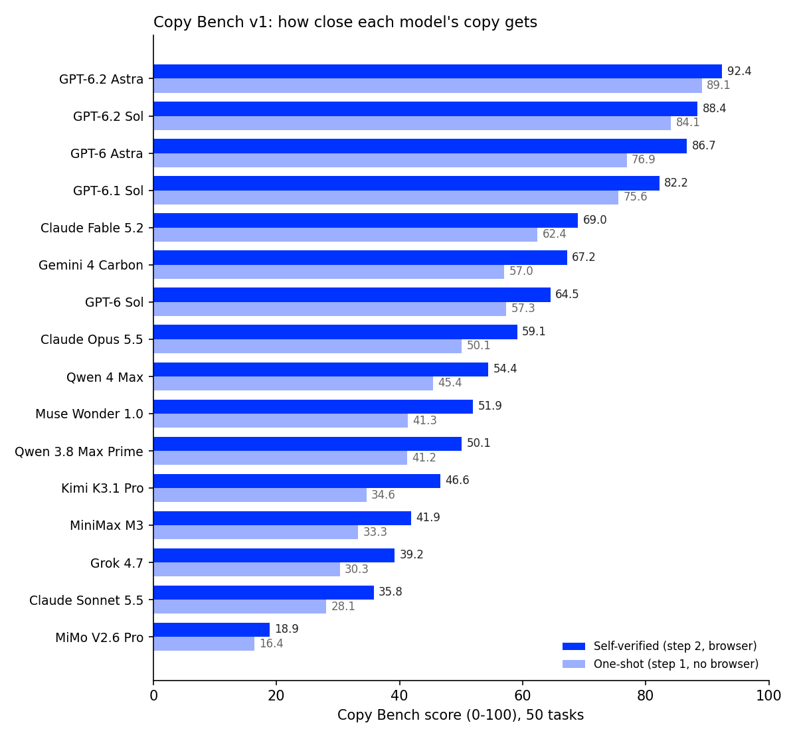
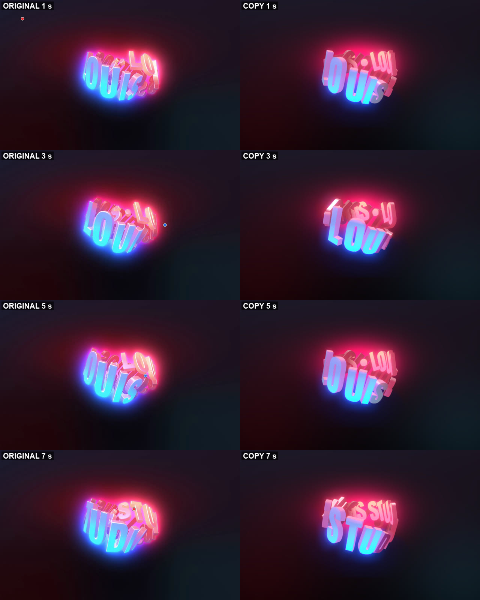
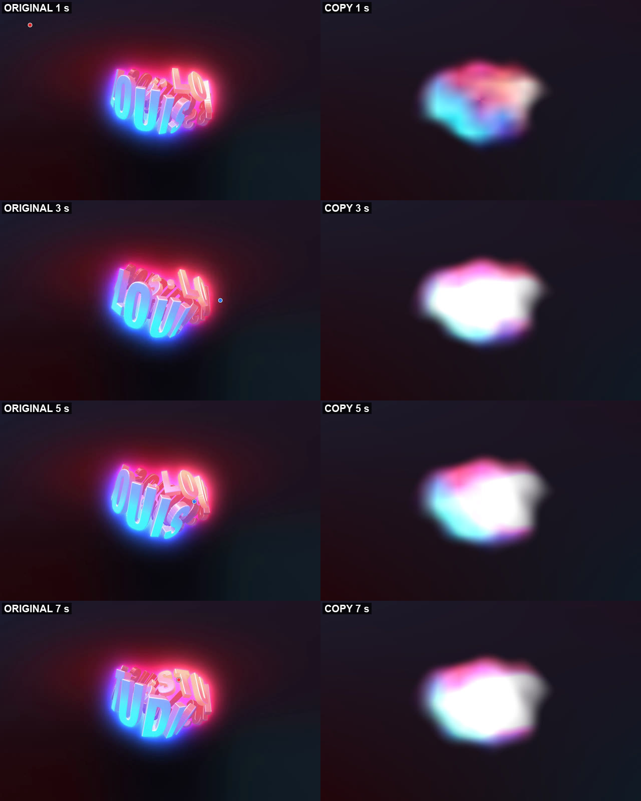

# Copy Bench on Valkyrie

Copy Bench measures how well models rebuild complex web components from a screen recording: WebGL, shaders and multi-step interactive animations.

Full results and every copy next to its original: **https://21st.dev/benchmarks/copy**

## How it works

Copy Bench measures how well a model can rebuild a moving web component from a screen recording. The agent gets an
8 second video of a page (WebGL scenes, shaders, canvas animations, mouse-driven effects) and has to write one
`index.html` that looks and moves the same.

This repo is a public subset of Copy Bench (13 of the 50 tasks), packaged as a [Valkyrie](https://github.com/vals-ai/Valkyrie)
dataset you can push and run as is. Full write-up and results: https://21st.dev/benchmarks/copy

## Why frontier models still get it wrong

We ran 13 models on all 50 tasks (650 copies per step, 1,300 in total). The best model gets 86.7 out of 100 when it can
check its work in a browser, and only 76.9 when it can't. Most models land between 35 and 70. The hard part is motion:
models get the colors and the layout roughly right, then miss how fast things spin, how a shape morphs, what happens
under the mouse, or what a shader actually looks like over time.

| Model | Harness | One-shot | Self-verified |
|---|---|---:|---:|
| GPT-6 Astra | Codex | 76.9 | 86.7 |
| GPT-6.1 Sol | Codex | 75.6 | 82.2 |
| Claude Fable 5.2 | Claude Code | 62.4 | 69.0 |
| Gemini 4 Carbon | Gemini CLI | 57.0 | 67.2 |
| GPT-6 Sol | Codex | 57.3 | 64.5 |
| Claude Opus 5.5 | Claude Code | 50.1 | 59.1 |
| Muse Wonder 1.0 | Muse Code | 41.3 | 51.9 |
| Qwen 3.8 Max Prime | Qwen Code | 41.2 | 50.1 |
| Kimi K3.1 Pro | Kimi Code | 34.6 | 46.6 |
| MiniMax M3 | MiniMax Code | 33.3 | 41.9 |
| Grok 4.7 | Grok Build | 30.3 | 39.2 |
| Claude Sonnet 5.5 | Claude Code | 28.1 | 35.8 |
| MiMo V2.6 Pro | MiMo | 16.4 | 18.9 |



Scores are on all 50 tasks, graded offline by two vision judges (GPT-6.1 Sol and Claude Opus 5.5). Letting the model
look at its own page in a browser raised the score on 418 of 650 copies and lowered it on 100.

Each model ran in its maker's own agent harness (Codex, Claude Code, Gemini CLI, ...), because that's how people
actually use these models for frontend work, and it keeps us from handicapping a model with a harness it wasn't tuned
for. On Valkyrie the same tasks run with any agent from the public registry, for example Claude Code or Codex.

## Failure modes

- **Rebuilding the wrong thing, confidently.** Weaker copies get the vibe and miss the content. Below, the same
  task (Neon Loop, 3D rings of letters) copied by GPT-6 Astra and by MiMo V2.6 Pro, as the in-run grader sees it.
  MiMo's copy is a blown-out glow with no letters at all. Some models also rebuild a famous demo they remember
  instead of what the video shows.
- **Checking your own work doesn't always help.** Self-verifying raised the score on 418 of 650 copies, but lowered
  it on 100: the model "fixes" things that were right, or breaks the page while editing.
- **Copies that never render.** 152 of the 1,300 steps hit the time limit, and 31 left no `index.html` at all.

GPT-6 Astra (close copy):



MiMo V2.6 Pro (letters gone, only the glow is left):



## Task anatomy

Every task has two steps that run in the same sandbox:

1. **first** (one-shot, 30 min): the agent gets `video.mp4`, `steps.json` (the mouse/scroll script used during the
   recording) and `cb-frames` (a small tool that pulls frames out of the video). There is no browser, so the agent
   can't render its page.
2. **fix** (self-verified, 20 min): a headless browser (`agent-browser`) gets unlocked, and the agent can open its own
   page, compare it with the recording, and fix it.

```
tasks/
  dataset.toml              pins the 13 tasks by digest
  t84-3d-letter-rings/
    task.toml               two steps, time limits, network allowlist, judge secrets
    environment/            Dockerfile, the video, steps.json, cb-frames
    steps/first/instruction.md
    steps/fix/instruction.md
    steps/fix/workdir/      setup.sh that unlocks the browser for step 2
    tests/                  the grader (only uploaded at grading time, the agent never sees it)
      test.sh, grade.py, capture.mjs, prompt.md, checklist.py
      ref/                  4 reference frames from the original's recording
```

The browser is in the image from the start, but encrypted. Its key only shows up in step 2, so step 1 really is blind.

During the agent's turn the network is an allowlist: model APIs (so the agent can think) and four library CDNs
(esm.sh, unpkg, jsdelivr, cdnjs, so it can use three.js or GSAP like the originals do). Nothing else. Most originals
are public, so open internet would let an agent download the source instead of copying it from the video.

## How scoring works

After each step, `tests/grade.py` runs inside the sandbox:

1. No `index.html` gets 0.
2. It serves the workspace, opens the copy in headless Chromium at 1280x800, replays the same mouse/scroll script,
   and takes screenshots at the same 4 timestamps as the reference frames.
3. It builds one contact sheet (original on the left, copy on the right, one row per timestamp) and asks one vision
   judge a fixed checklist: content, layout, color, typography, motion (26 checks, each `same`, `minor`, `major` or
   `n/a`).
4. The score is computed in code, not by the model: each dimension is 100 minus 15 per minor and 40 per major,
   overall is a weighted mean (content 25%, layout 25%, motion 20%, color 15%, typography 15%).
   Reward = overall / 100.

The task reward is the score of the last step (self-verified). The one-shot score is recorded in the step results.
`/logs/verifier/` keeps the copy, the sheet, the judge's answer (`judge.json`) and a log.

The judge key comes from a run secret: `anthropic-api-key` (Claude, default `claude-opus-5-5`) or `openai-api-key`
(default `gpt-6.1-sol`). Set the secret `copy-bench-judge-model` to use a different model. Without a key, the run
still finishes but isn't judged: reward 1 if `index.html` exists, and `graded_share` in the dataset score shows that.
If grading breaks for any other reason (for example the agent deleted the browser), the reward is 0, so breaking the
grader never pays.

The dataset score on Valkyrie is the mean reward over the tasks. `reward.json` also carries the per-dimension scores
(`content`, `layout`, ...) and the task kind (`kind_3d`, ...). The hosted Valkyrie doesn't take a custom `metric.py`,
so `scripts/metric.py` does the breakdown offline from exported rewards (errors count as 0, dimensions averaged over
judged tasks, `graded_share` = share of tasks that were really judged).

## Run it on Valkyrie

After `valkyrie login` and connecting Modal (see the [quickstart](https://github.com/vals-ai/Valkyrie)):

```bash
valkyrie dataset push copy-bench/copy-bench ./tasks --tag v1

valkyrie agent install https://github.com/vals-ai/public-agent-registry/tree/main/examples/claude_code-v1.0.0
valkyrie secret set anthropic-api-key

valkyrie run start --agent claude_code-v1.0.0 --dataset copy-bench/copy-bench@v1 \
  --model anthropic/claude-opus-5-5 --provider modal \
  -s ANTHROPIC_API_KEY anthropic-api-key --slice 0:1 --concurrency 1 --connect

valkyrie tui
```

Drop `--slice 0:1` to run all 13 tasks. The image builds for linux/amd64 and the first build takes a few minutes.

## Known limits

- **WebGL renders in software in the sandbox.** The reference recordings were made on macOS with GPU rendering.
  In a Linux sandbox Chromium draws WebGL and shaders with SwiftShader, so a correct WebGL copy can look a little
  different from the reference (shading, bloom, smoothness). The judge prompt says so, and the per-task note about
  what varies between loads of the original is passed through. Our published results were captured on the same
  machine for both sides, so they don't have this problem.
- **One judge, 4 frames.** The published results use two judges on full recordings (16 frames plus video). The
  in-run grader is a lighter version of the same checklist and scoring, so expect its numbers to be close, not equal.
- **The verifier shares the sandbox with the agent.** It decrypts its own copy of Chromium and calls system binaries
  by absolute path, but a determined agent running as root could still tamper with the sandbox.
- No reference solutions are included (the originals' source isn't redistributed), so there's no oracle run.

## What's in this subset

13 of the 50 tasks: 7 components from the 21st.dev catalog and 6 open-source demos under permissive licenses (MIT or
Apache-2.0). See [ATTRIBUTION.md](ATTRIBUTION.md). The other 37 tasks are held out so the benchmark stays useful.

`scripts/build_tasks.py` rebuilds `tasks/` from our internal lab checkout, and `scripts/lock.py` rewrites
`dataset.toml` and runs the Valkyrie CLI's own pre-push checks.

## Judging notes

- **Novelty**: video in, working code out, graded on motion as well as looks. Most UI benchmarks grade a static
  screenshot or the DOM.
- **Difficulty**: the best model scores 86.7 with a browser, and the field spreads from 18.9 to 86.7.
- **Execution**: the full run is 13 models x 50 tasks x 2 steps, two judges, with a human-graded check on 249 copies.
  This repo validates with Valkyrie's own task validator and CLI pre-push checks.
- **Importance**: "make it look like this" is one of the most common frontend asks, and motion is where agents fall
  short today.
- **Clarity**: one task = one video, one file out, one checklist score.

## License

Code (grader, scripts, metric) is MIT, see [LICENSE](LICENSE). The task recordings show components from 21st.dev and
open-source demos. They're included for evaluation only, under the terms listed in [ATTRIBUTION.md](ATTRIBUTION.md).
